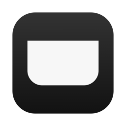

<div align="center">



# Rounded Corners

**Rounds the corners of your Mac's display with unobtrusive, native overlays.**

[](https://www.apple.com/macos/)
[](https://www.apple.com/)
[](LICENSE)

</div>

---

## Overview

A lightweight macOS utility that rounds the corners of your screens with four small black panels:

- **Smart Laptop Support**: A MacBook's top corners are already physically rounded by the glass display bezel, so by default only the bottom corners are drawn (up to 23 pt). Above that threshold, all four are drawn.
- **Multi-Monitor**: External displays can have each selected corner rounded independently or share a global preset.
- **Ultra-lightweight**: Single Objective-C file, system frameworks only, 0% CPU at rest.
- **Zero clutter**: No menu bar icon, no Dock clutter while running in the background.

## Features

- **Seamless Desktop Integration**: Corners stay fixed during Space swipes and remain visible over full-screen apps and the lock screen (using private SkyLight APIs, falling back gracefully to standard all-Spaces windows).
- **Screenshot Clean**: Corner overlays are excluded from screen captures (`NSWindowSharingNone`), naturally mimicking the physical bezel of the display.
- **Per-Display Customization**: Easily configure radius and toggle individual corners for each connected screen or apply changes globally.
- **Launch at Login**: Simple toggle to start automatically in the background.

## Usage

Opening the app reveals the preferences panel:
- Configure corner radius and toggle individual corners.
- Choose whether settings apply globally or per display.
- Enable or disable **Launch at login**.

Closing the window keeps the corners active while removing the app from the Dock.
- **To reopen preferences**: Double-click the app in `/Applications`.
- **To quit**: Press <kbd>Cmd</kbd> + <kbd>Q</kbd> while the window is open or click **"Quit Rounded Corners"**.

## Build & Installation

### Requirements
- Apple Silicon Mac (M1/M2/M3/M4)
- macOS 13 (Ventura) or newer
- Xcode Command Line Tools (`xcode-select --install`)

### Building from source

```bash
./build.sh            # build/Rounded Corners.app (arm64, ad-hoc signed)
./build.sh install    # build, install to /Applications, and launch
./build.sh zip        # package build/RoundedCorners.zip
./build.sh dmg        # package build/RoundedCorners.dmg
./build.sh test       # run the test suite
```

> **Note**: Use `./build.sh install` before enabling "Launch at login". macOS registers login items by exact bundle path; running it from `build/` will break if that directory is cleaned or rebuilt.

### Gatekeeper Note
The app is ad-hoc signed and not notarized. On another Mac, after downloading or unzipping to `/Applications`, right-click > **Open** on first launch, or run:

```bash
xattr -dr com.apple.quarantine "/Applications/Rounded Corners.app"
```

## License

This project is licensed under the **PolyForm Noncommercial License 1.0.0**.

- **Free for Personal Use**: You are free to download, build, modify, and run this application for personal, educational, or non-profit purposes.
- **Commercial Use Prohibited**: You may not sell, monetize, redistribute for commercial gain, or incorporate this software into commercial products without prior written permission.

See the [LICENSE](LICENSE) file for the full legal terms.
